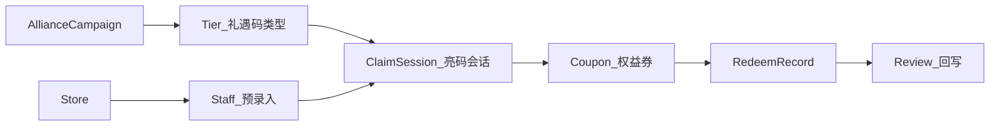
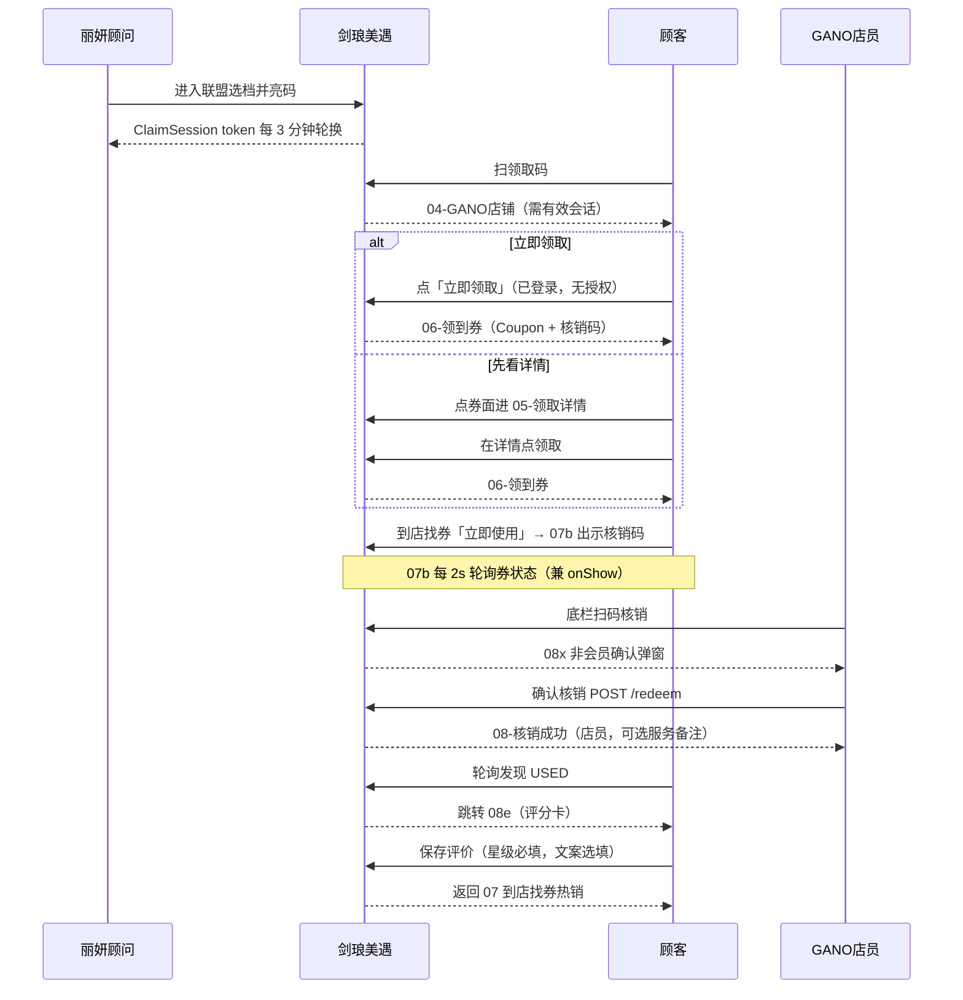
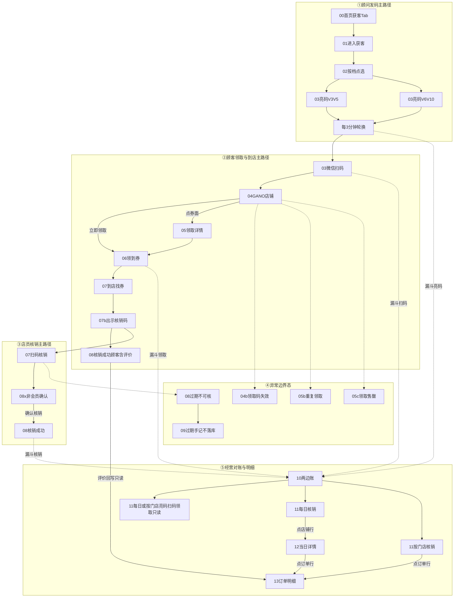
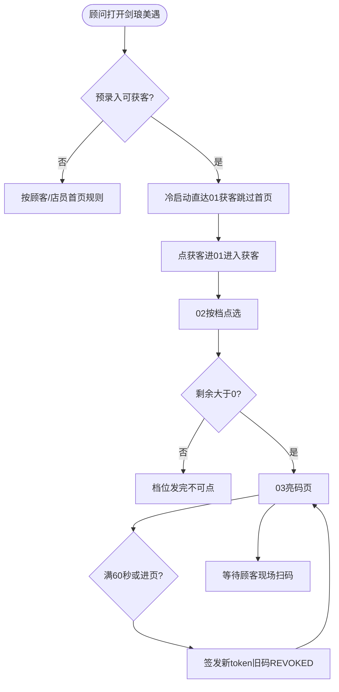
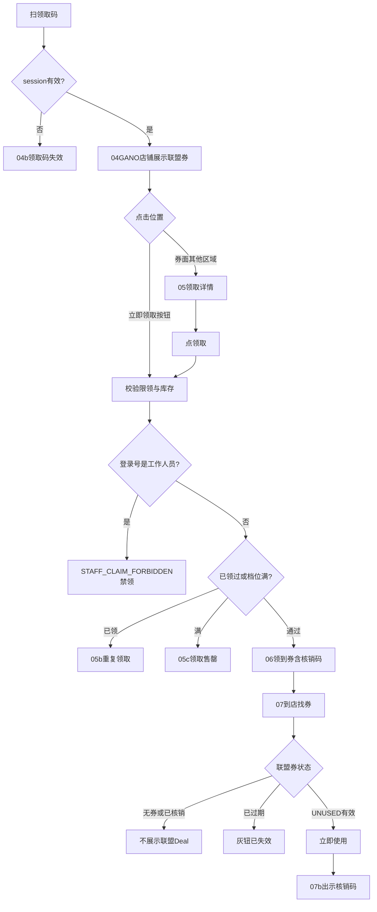
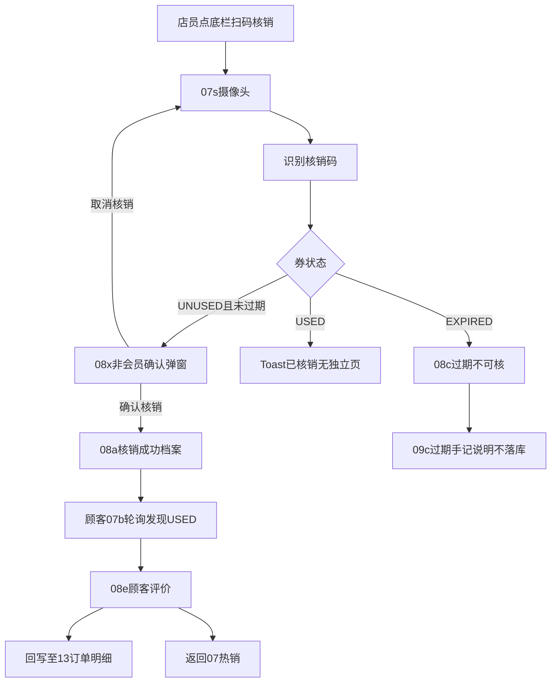
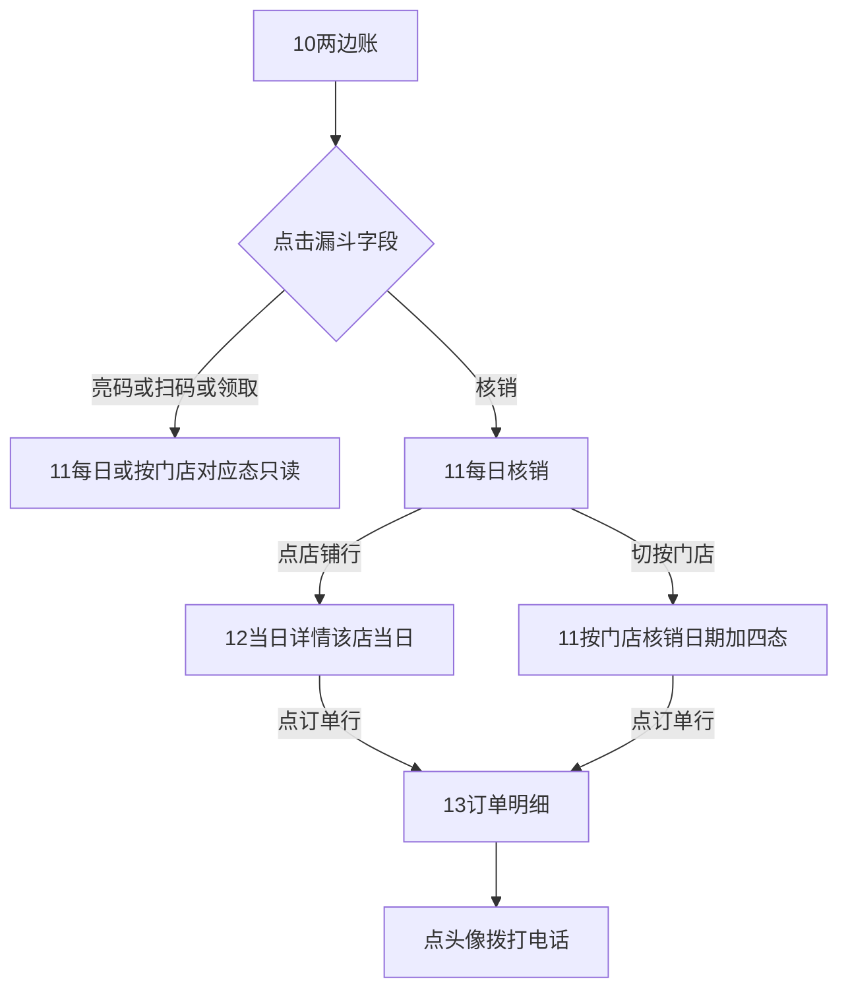
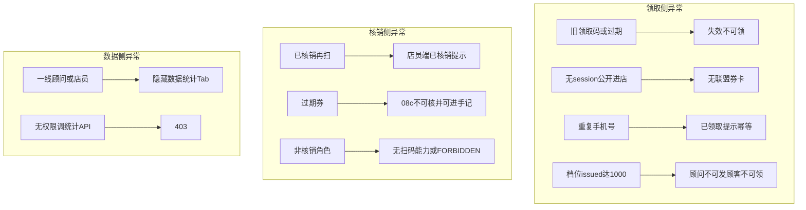

# 剑琅美遇 · 联盟核销 PRD（A 向：丽妍雅集 → GANO）

| 项 | 内容 |
|----|------|
| 产品 | 微信小程序「剑琅美遇」 |
| 版本 | **v1.27**（2026-11-13：10 时间范围筛选） |
| 读者 | 前端 / 后端 / 测试 |
| UI 源 | Figma `gYtPZtAsGCSg3c2pUdtnGT`（A 向 5 泳道 + **B 向购卡礼关键帧**） |
| 原型参考 | [`data-prototype.html`](../data-prototype.html) · [`alliance-flow-A-storyboard-spec.html`](../alliance-flow-A-storyboard-spec.html) |
| 文档路径 | `docs/prd-剑琅美遇-联盟核销.md` · HTML 浓缩版同步 |

UI 以 Figma 为准；本文写清职责、状态机、权限、统计口径与接口契约，不复述像素级样式。

**v1.27 变更摘要（相对 v1.26）**

1. **30R 两边账时间范围**：屏 10 Hero 右侧时间范围（大日历图标胶囊）；Sheet 内 **快捷胶囊两行 3+2** + **下方直接月历**（无二级「自定义」页）；点快捷即生效并关；改日历后须点「完成」；账号记忆；首次默认「全部」；与 11 独立；跨度不限。原型已示意，**待确认后再导 Figma**。

**v1.26 摘要（仍有效）**：撤销 28M 店长模式。

**v1.25 摘要（仍有效）**：29S 工作人员禁领。

**v1.24 摘要（仍有效）**：§04-M 地图争议项拍板（页内查店、直线距离、静默授权等）。

**v1.23 摘要（仍有效）**：页内 `<map>` 查店；卡头文案 / 白卡 700 / 角标「联盟优惠」等人工改稿同步。

**v1.22 摘要（仍有效）**：12 表头「发券门店」→「核销门店」。

**v1.21 摘要（部分仍有效）**：11 L3 一律门店人；顾客号仅 12（及 13）。（原「21」本店明细随店长模式撤销。）

**~~v1.20 / v1.19 / v1.18~~**：店长模式今日表 / 员工详情 / 排行相关，**已随 v1.26 撤销**。

**v1.17 摘要（部分仍有效）**：L2 人数/金额间距；按门店 ↓/↑。（28M 店长模式 / 屏 20–22 **已撤销**。）

**v1.16 摘要（仍有效）**：27E 三层展开；L3 号码角色；被核销进 12/13。

**v1.15 摘要（仍有效）**：24R 被核销文案；25L 13 本单人员四人号；26C 可点 ›。  

**v1.14 摘要（仍有效）**：23Q 活动码均可微信扫一扫拉起小程序。

---

## 0. 决策记录（已锁定）

| # | 项 | 结论 |
|---|----|------|
| 1A | 端范围 | 仅「剑琅美遇」；丽妍顾问与 GANO 店员共用，能力由角色/门店门控 |
| 2C | 多项目码（**仅 A 向**） | A 向全程不选品；金额及相关统计一律取该档**最高价项目**（如 V3–V5→218）。**不**适用于 B 向满 10000 |
| 15B | B 向组合礼计价 | 购卡满 10000：**两项均享**（紫镜 ¥980 + 归元暖腹 ¥380）；展示可分列；**记账/核销/漏斗金额 = ¥1360**（两价之和）。禁止按二选一或 `max(price)` |
| 3A | 限量 | 每类礼遇码/档位**全局共 1000**（v1 写死；限量管理后台后续版） |
| 4A | 亮码时效 | 每 **3 分钟**自动换新；**旧码立即失效** |
| 13N | 店员备注 | 08a 可填可选**服务备注**（≠顾客评价）；顾客评价仅 08e |
| 14P | 明细手机号 | **12 列表脱敏**；**13 订单明细**对核销员/店长/运营可展示**完整号** |
| 5B | 角色能力 | 顾问=亮码发券；店员=扫码核销；一线不可见「数据」；店长/品牌运营可见 |
| 6A | 文档形态 | 单份中文 Markdown（本文）+ HTML 浓缩版 |
| 7C | 数据范围 | 店长/运营均可看**联盟两侧全量**（发券侧 + 核销侧） |
| ~~28M~~ | ~~店长模式~~ | **v1.26 撤销**：不再提供数据模块内店长模式切换及屏 20–22 |
| 8P | 核销顾客感知 | v1 **不做推送/WebSocket**；顾客停在 **07b**（或券详情）时 **每 2s 轮询**券状态（兼 `onShow` 拉一次）；`USED` → 跳 **08e** |
| 9R | 评价返回 | 「保存评价并返回」成功后 → **07 到店找券（热销 Tab）** |
| 10M | 过期手记 | v1 **不落库**；仅店员结果说明页；**不进**核销/漏斗统计 |
| 11D | 07 联盟券显隐 | 无券或不存在 / `USED` → 热销顶 **不渲染**联盟 Deal；`EXPIRED` → 展示且右侧灰钮「已失效」；`UNUSED` 有效 →「立即使用」 |
| 12T | 统计日切 | **Asia/Shanghai** 自然日 |
| 16S | 10 顶区获客 | 「丽妍雅集 获客」= **对方发来且在本品牌核销成功人数**；「GANO 获客」= **本侧发出且在 GANO 核销成功人数**（与两块「到××核销」口径一致；示意只读，钻取仍点漏斗数值行） |
| 17H | 核销后首页 | 顾客券 `USED`（核销成功即可，**不要求**已评价）后，杀掉小程序再进入 → **线上常规首页**；不再套用本活动特有首页/入口改写。已领未核杀进程再进 → 仍可按活动规则找回券（07 Deal / 07b 等） |
| 18O | 团购活动订单 | 本活动订单落入「我的订单 → 团购活动 → **已使用**」；**仅**此状态（无待支付/已支付/已退单）；`POST /redeem` 成功瞬间落库；UI 复用线上「已使用」壳，字段见 §6.7 |
| 19D | 经营钻取 | **每日 / 按门店**均四态。L1 日/店卡 → L2 门店行（每日）展开 **L3 门店人手机号·次数**。亮码/扫码/领取 L3=**顾问**；被核销 L3=**核销店员**，再点 L3 →12（**12 才见顾客号**）→13。每日筛：时间+四态+门店；按门店筛：日期+四态。发出/发来对称 |
| 27E | 三层展开 | 点 L2 向下展开/收起 L3（∨ / ›）；L3 左脱敏号、右次数；仅被核销 L3 带 › 可进 12 |
| 20L | 顾问冷启动 | 识别为预录入**可获客**角色（A 向丽妍顾问；B 向可获客 GANO 顾问）→ 启动**直达获客**（`01` / `B01`），**跳过首页**。纯核销店员、顾客不走此规则。与 17H（仅顾客）分立 |
| 21S | 领券截图提示 | `06` / `B06` 核销码下方固定提示：「**可将核销码截图保存，到店出示即可**」 |
| 22R | 核销前非会员确认 | 扫码识别到可用券后、进入 08a **之前**弹窗；文案确认本店非会员及活动条件；「**取消核销**」「**确认核销**」。系统仍**不对接**会员库；确认后才进入 08a / 完成核销。A/B 同构 |
| 23Q | 活动码拉起小程序 | 本活动**所有业务码**（联盟礼遇码、顾客核销码等）必须使用**可打开本小程序**的载体（微信小程序码 / 小程序 URL Link 等），**禁止**无跳转纯图片码。未打开过小程序的用户用**微信扫一扫**扫描 → **直接拉起「剑琅美遇」**并带 `path + 业务参数`（如 `sessionToken` / 券 id）进入对应页；再按现规则登录与角色分流。店员亦可用微信扫一扫扫核销码进核销流；小程序内「扫码核销」保留作备用。**UI 不展示**「可用微信扫一扫打开剑琅美遇」一类说明文案 |
| 24R | 漏斗末态文案 | 10 / 11 Chip / 漏斗 Sheet 第四态展示名 = **「被核销」**（非「核销」）。每张卡四态 = **同一来源码**从亮码到被核销的全过程。动作文案（扫码核销、确认核销、到××核销）**不变** |
| 25L | 本单人员四人号 | 13 增「本单人员」卡：亮码人 / 扫码人 / 领取人 / 核销人手机号；12 列表仍只展示顾客脱敏号；亮码/扫码/领取不下钻 |
| 26C | 可点 › | 11 被核销·店铺行、按门店·订单行、12 列表行右侧灰色 `›`；按压浅灰底可选 |
| 29S | 工作人员禁领 | 预录入 `Staff` 名单内**全部角色**（丽妍/GANO 顾问、店员、店长、运营等）**禁止领取**本活动联盟礼遇券。判定：登录手机号 ∈ `Staff.mobile`。必须在 **`POST /coupons/claim` 服务端**拦截（前端可提示，不可只做 UI）。错误码 `STAFF_CLAIM_FORBIDDEN`；文案「**活动工作人员不可领取本联盟礼遇**」。A/B 向同规则。不影响亮码/核销/看数。历史疑似自领券列出给人工作废，**不自动批量作废** |
| 30R | 10 时间范围 | Hero **右侧**胶囊（**大日历图标** + 文案 + ∨）。Sheet：**快捷胶囊**两行（今天/本周/上周 · 本月/全部）+ **同屏月历**。点快捷 → **立即生效并关 Sheet**；在月历点起止 → 取消快捷高亮，须点「**完成**」才生效；跨度**不限**；起终点可互换纠偏。日切 **Asia/Shanghai**；本周/上周 = **周一～周日**。作用于屏 10 获客+漏斗；与 11 **独立**。**记忆**：账号持久化；无记录默认 **全部**。`GET /stats/overview` 增加 `from`/`to`（或 range 枚举） |

**业务补充（产品方）**

1. 双方门店信息、可亮码店员手机号预录入剑琅美遇。  
2. 亮出的礼遇码与亮码店员手机号绑定，便于对账。  
3. **A 向**一码多项目（如 V3–V5）统计取最高价；券面可并列，系统**不**存口头选项。**B 向**满 10000 为两项均享，统计取**合计 ¥1360**（见 15B）。  
4. 每次亮码刷新；有效期 **3 分钟**；到期亦刷新（与 4A：旧码立即失效一致）。  
5. 顾客扫联盟礼遇码落地页为「04-GANO 店铺」（`qrPayload` = 小程序 path + `sessionToken`）。**所有活动业务码**均须可被微信扫一扫拉起本小程序（见 23Q）。  
6. 点击顾客圆形头像可拨打其手机（**列表/当日详情脱敏**；**13 明细页可完整展示**；拨号用完整号；仅核销员/店长/运营）。  
7. 每类礼遇码 v1 限领 1000；后续做限量管理。  
8. 底栏「扫码核销」进扫码页；「数据统计」进「10-两边账」（仅店长/运营可见该项）。  
9. 实现与联调以人工修订后的 Figma 为准。  
10. `04`：点「立即领取」直接发券进 `06`；点券面其他区域进 `05-领取详情`（详情页再点领取同直达 `06`）。未登录先完成小程序登录再 claim，**仍无**手机号授权 Sheet。  
11. 出示核销码本需求单出 `07b`；一次性活动无券列表 / 无 08-已核销复看页。  
12. Figma 按「顾问发码 / 顾客主路径 / 店员主路径 / 异常 / 经营」五行排布（改 A）。  
13. 评价：`rating` **必填** 1–5；文案选填 0–500；仅顾客可写；回写只读见 13。  
14. 店员 08a：可选服务备注 +「确认并返回」；**不可**代写顾客星评。  
15. 核销完成后重启小程序：首页恢复线上常态（见 17H）；订单仍见「团购活动·已使用」（见 18O）。  
16. 可获客顾问冷启动直达获客（20L）；06 截图提示（21S）；核销前非会员弹窗（22R）；活动码微信扫一扫拉起小程序（23Q）。

---

## 1. 背景与目标

### 1.1 一句话

用丽妍雅集顾问作 GANO 获客渠道：顾问按会员档位亮「联盟礼遇码」→ 顾客扫码领券 → 到 GANO 核销体验 → 回写评价 → 店长/运营看双边漏斗与明细。

### 1.2 本版目标

- 打通 A 向闭环：亮码 → 扫码 → 领取 → 核销 → 回写 → 数据钻取。  
- 领取码与核销码分模型；亮码归因到店员手机号与门店。  
- 提供店长/运营可看的双边对账与明细下钻。

### 1.3 非本版 / 分期（见 §10）

- B 向**完整工程闭环**（核销侧全链路、异常态、经营钻取镜像）可分期；**档位权益与合计计价（15B）已锁定**，Figma 已出关键帧。  
- 限量后台配置、与双方会员系统对接校验。  
- 灰度发布策略。

---

## 2. 角色与权限矩阵

鉴权：微信登录拿到手机号后，与预录入「可亮码/可核销店员名单」匹配；未录入按顾客处理。

| 角色 | 典型身份 | 联盟（获客/亮码） | 扫码核销 | 数据统计 | 说明 |
|------|----------|------------------|----------|----------|------|
| 丽妍顾问 | 一线发券 | ✓ 选档亮码 | ✗ | ✗ | **冷启动直达获客**（20L）；获客区内底栏隐藏「数据统计」 |
| GANO 店员 | 一线核销 | ✗（本向） | ✓ | ✗ | 首页**无**「获客」；核销前须过非会员确认弹窗（22R）；获客区内底栏隐藏「数据统计」 |
| 店长 | 丽妍或 GANO 本店负责人 | 按所属品牌能力 | 按所属品牌能力 | ✓ | 联盟两侧全量（10→11→12→13） |
| 品牌运营 | 丽妍或 GANO 运营 | 视配置 | 视配置 | ✓ | 同店长，双边全量 |
| 顾客 | 未在店员名单 | ✗ | ✗ | ✗ | 扫码领券、到店找券、「立即使用」出示核销码（无券列表） |

**说明**

- A 向：发券侧为丽妍门店顾问；核销侧为 GANO 门店店员。  
- 资格：系统**不对接**会员库。亮码侧档位仍靠顾问判断；**核销侧**增加弹窗强制确认「本店非会员 + 活动条件」（22R），取消则不核销。  
- 顾客端不展示 VIP 分档文案（不出现「V3–V5」等对客等级字）。

---

## 3. 对象模型



| 对象 | 说明 |
|------|------|
| **AllianceCampaign** | 一次联盟活动（本版：丽妍×GANO A 向） |
| **Tier（礼遇码类型/档位）** | 如 `V3_V5`、`V6_V10`；含权益文案、海报、项目列表与标价、全局限量 |
| **ClaimSession（亮码会话 / 领取码）** | 顾问亮出的动态码；绑定 `staffPhone`、`storeId`、`tierId`；TTL=**180s**；轮换后旧 token 立即失效 |
| **Coupon（权益券）** | 顾客已登录小程序，点「领取」直接发券（**不再弹手机号授权**）；含核销码、有效期、条款快照；一活动一人一券 |
| **RedeemRecord** | 核销成功记录；核销门店、店员、时间、可选 `staffNote`；统计金额按档规则计入 |
| **Review** | 核销后顾客评价：`rating` 1–5 + 选填文案；只读展示于发券侧 **13 订单明细**（无独立看回写页） |
| **Store / Staff** | 预录入双方门店与可操作手机号及角色 |

**两个二维码（禁止混用）**

| 码 | 载体 | 用途 | 有效期 |
|----|------|------|--------|
| 领取码（联盟礼遇码） | ClaimSession | 顾客扫码进入店铺领券 | **3 分钟**，自动轮换，旧码即废 |
| 核销码 | Coupon | 到店出示给店员扫 | 随券有效期（默认领券起三个月） |

---

## 4. 主流程与状态机

### 4.1 主成功路径



### 4.2 ClaimSession 状态

`ACTIVE` →（**180s** 到期或主动轮换）→ `REVOKED`  
扫已 `REVOKED` / 不存在 token → 提示领取码失效，不可领。

### 4.3 Coupon 状态

| 状态 | 含义 | 可核销 |
|------|------|--------|
| `UNUSED` | 已领取未用 | 有效期内 ✓ |
| `USED` | 已核销 | ✗ |
| `EXPIRED` | 过期 | ✗（可展示「过期手记」引导店内手工接待，系统不记核销） |

### 4.4 异常路径（须覆盖）

| 场景 | 表现 |
|------|------|
| 领取码过期/已轮换 | 扫后提示失效，不进可领态 |
| 公开进 GANO 店（无有效 ClaimSession） | 不展示联盟优惠券卡，不可领 |
| 本活动已领过（同登录手机号） | 重复领取提示；接口幂等 |
| **工作人员领取（29S）** | 登录手机号命中预录入 Staff → claim **拒绝**；Toast/页提示「活动工作人员不可领取本联盟礼遇」；错误码 `STAFF_CLAIM_FORBIDDEN` |
| 档位全局已发满 1000 | 顾问端不可亮/不可发；顾客端不可领 |
| 券已核销 | 店员扫后 Toast/结果提示「已核销」；顾客侧 07 **不再展示**该联盟 Deal |
| 券过期 | 店员扫 → 08c；可选进 09c 说明页（**不落库**）；顾客侧 07 展示灰钮「已失效」 |
| 顾客无此类券 | 07 热销顶 **不展示**联盟 Deal |
| 非名单店员开联盟/核销 | 无对应 Tab 能力或提示无权限 |

### 4.5 页面流程图

#### 4.5.1 总览泳道（A 向）



#### 4.5.2 发券亮码流



#### 4.5.3 顾客领券流



#### 4.5.4 核销回写流



#### 4.5.5 数据钻取流



#### 4.5.6 异常总图



---

## 5. 页面清单

设计稿尺寸 390×844。Figma 按角色分 **5 行**（主路径与异常分行，改 A）。

- **可获客角色冷启动（20L）**：预录入可获客顾问打开小程序 → **直达** `01` / `B01`，**不经过首页**。  
- **小程序 C 端首页底栏（顾问，若从获客返回或非冷启动）**：**首页 / 我的 / 获客**；非顾问仅 **首页 / 我的**（无获客）。点「获客」→ `01-进入获客`。  
- **联盟获客区内底栏**：**联盟 / 扫码核销 / 数据统计**（一线无「数据统计」）。  
- **领取**：**无**手机号授权弹层；`05` 为 **领取详情**（非授权页）。  
- `04`：**立即领取**直达 `06`；点券面其他区域进 `05`。  
- **出示核销码**：`07b` 本需求单出；无券列表。  
- 产品文案：数据下钻标题统一 **「数据明细」**。

### 5.1 ① 顾问 · 发码（主路径）

| 编号 | 名称 | 节点（参考） | 角色 | 职责 / 关键字段 | 主要跳转 |
|------|------|--------------|------|----------------|----------|
| 00 | 小程序首页 | `198:436` | 顾客/店员等；顾问冷启动**不落此页** | 精选活动、门店列表；底栏首页\|我的\|获客 | 获客 → 01 |
| 01 | 进入获客 | `75:2` | 顾问 | 本次合作卡片、适用门店概览 | → 02 |
| 02 | 按档点选 | `76:2` | 顾问 | 档位卡、剩余/总量（如 `/1000`）、已发完不可点 | → 03 |
| 02b | 档位已发完 | `244:201` | 顾问 | 两档均 `剩余 0/1000`、红字「已发完，不可再亮码」、整卡不可点 | — |
| 03a | 亮码 V3–V5 | `193:17` | 顾问 | 双项目票面 + QR；每 3 分钟轮换 | 顾客扫 → 04 |
| 03b | 亮码 V6–V10 | `77:2` | 顾问 | 单项目票面 + QR；绑定本店员手机 | 顾客扫 → 04 |

### 5.2 ② 顾客 · 领取与到店（主路径）

| 编号 | 名称 | 节点（参考） | 角色 | 职责 / 关键字段 | 主要跳转 |
|------|------|--------------|------|----------------|----------|
| 03c | 微信扫码 | `78:2` | 顾客 | 系统扫码示意 | → 04 |
| 04 | GANO 店铺 | `79:2` | 顾客 | 联盟券 CTA「立即领取」；**须有效会话** | 「立即领取」→ 06；点券面 → 05 |
| 05 | 领取详情 | `80:2` | 顾客 | 权益详情、条款；底栏领取（无授权） | → 06 |
| 05-V35 | 领取详情 V3–V5 | `226:201` | 顾客 | V3–V5 二选一详情 + 图文；底栏领取 | → 06a |
| 06a | 领到券 V3–V5 | `195:17` | 顾客 | 二选一礼遇 + 核销码；码下截图提示（21S） | → 07 |
| 06b | 领到券 | `81:2` | 顾客 | 核销码、有效期、适用门店；码下截图提示（21S） | → 07 |
| 06z | 核销码放大 | `246:201` | 顾客 | 深色蒙层 + 大码；点空白关闭 | 自 06 点击放大 |
| 07a | 到店找券 | `82:2` | 顾客 | 热销顶联盟 Deal：**无券/已核销不展示**；过期灰钮「已失效」；可用「立即使用」 | → **07b**（仅可用） |
| 07b | 出示核销码 | `270:144` | 顾客 | 票面 + 核销 QR（可放大）；**轮询**待核销 | `USED` → 08e |
| 08e | 核销成功-顾客 | `212:201` | 顾客 | 成功反馈 + 评分输入卡；底栏「保存评价并返回」 | 保存 → **07**；回写 → 13 |

### 5.3 ③ 店员 · 核销（主路径）

| 编号 | 名称 | 节点（参考） | 角色 | 职责 / 关键字段 | 主要跳转 |
|------|------|--------------|------|----------------|----------|
| 07s | 扫码核销 | `83:2` | 店员 | 底栏进摄像头扫核销码 | → 08x / 异常行 |
| 08x | 核销前确认 | `517:150` | 店员 | 非会员+活动条件确认；「取消核销」「确认核销」（22R） | 确认 → 08a；取消 → 07s |
| 08a | 核销成功 | `84:2` | 店员 | 档案、脱敏手机；**点头像拨打**；可选**服务备注** +「确认并返回」；**不可写顾客星评** | 确认 → 扫码/联盟首页 |

### 5.4 ④ 异常 / 边界态

| 编号 | 名称 | 节点（参考） | 角色 | 职责 | 触发 |
|------|------|--------------|------|------|------|
| 04b | 领取码失效 | `294:144` | 顾客 | **Dialog**（同 05c 款）；码过期/已轮换/无效 | 扫失效领取码 |
| 05b | 重复领取 | `215:201` | 顾客 | 本活动已领过 | 再次领取 |
| 05c | 领取售罄 | `250:201` | 顾客 | 弹窗「本档礼遇已发完」+「我知道了」 | 档位全局达上限 |
| 08c | 过期不可核 | `86:2` | 店员 | 不可核销原因 | 扫过期券 |
| 09c | 过期手记 | `90:2` | 店员 | 系统未核销的店内记录 | 自 08c |

> ~~08d 过期券~~ 已删。顾客过期态在 **07 到店找券** 联盟券灰态表达，无独立「不可用的券」复看页。

### 5.5 ⑤ 经营 · 对账与明细

| 编号 | 名称 | 节点（参考） | 角色 | 职责 |
|------|------|--------------|------|------|
| 10 | 两边账 / 数据 | `91:2` | 店长/运营 | Hero「联盟对账」+ **时间范围（30R）** + 双边获客；发出/发来漏斗**数值行** → 11；**无**评价摘要列表 |
| 11-亮 | 数据明细·每日·亮码 | `169:17` | 同上 | L2 门店行展开 L3 **亮码顾问**·次数；不可进 12/13 |
| 11-扫 | 数据明细·每日·扫码 | `418:142` | 同上 | L2 门店行展开 L3 **顾问**·次数；不可进 12/13 |
| 11-领 | 数据明细·每日·领取 | `418:425` | 同上 | L2 门店行展开 L3 **顾问**·次数；不可进 12/13 |
| 11 | 数据明细·每日·被核销 | `168:17` | 同上 | L2 门店行展开 L3 核销员·次数；点 L3 › → 12（顾客在 12） |
| 11c-亮 | 按门店·亮码 | `433:152` | 同上 | 店卡展开 L3 亮码顾问·次数；无门店筛 |
| 11c-扫 | 按门店·扫码 | `433:247` | 同上 | 店卡展开 L3 **顾问**·次数 |
| 11c-领 | 按门店·领取 | `433:342` | 同上 | 店卡展开 L3 **顾问**·次数 |
| 11c | 按门店·被核销 | `178:17` | 同上 | 店卡展开 L3 核销员·次数；点 L3 › → 12；**无门店筛** |
| 11d | 发来·每日·被核销 | `294:155` | 同上 | 发来侧；规则同 11 |
| 11e | 发来·按门店·被核销 | `418:330` | 同上 | 发来侧；规则同 11c |
| 12 | 当日详情 | `171:17` | 同上 | 自被核销 L3 核销人进入（日+店+人）；表头「顾客·**核销门店**·项目」（对面核销店）；行右 `›` → 13 |
| 13 | 订单明细 | `172:17` | 同上 | 单笔详情 + **本单人员四人号** + 评价回写只读；点头像拨打 |

> ~~09b 看回写~~（`89:2`）已删。回写只读并入 **13**。发来侧按门店·亮/扫/领：**同壳换筛**，可不出独立帧。
| 11-日期 | 日期 Sheet | `247:201` | 同上 | 标题「选择日期」；「全部」+ 单月日历；**无副文案**；按门店日期 Chip 打开 |
| 11-时间 | 时间范围 Sheet | `432:253` | 同上 | 标题「选择时间范围」；近7天/近30天/本月/上月；**无副文案**；**仅每日** |
| 11-门店 | 门店 Sheet | `432:142` | 同上 | 标题「选择门店」；全部+该侧门店；**无副文案**；**仅每日**第三 Chip；底图每日页 |
| 11-漏斗 | 漏斗筛选 Sheet | `251:201` | 同上 | 标题「选择漏斗态」；亮码/扫码/领取/**被核销**；选中「已选」；**无副文案**；每日行 |
| 11-漏斗·按门店 | 漏斗筛选 Sheet | `437:296` | 同上 | 与 `251:201` 同交互；挂按门店子泳道 |
| 11-空态 | 数据空态 | `252:201` | 同上 | 「该筛选条件下暂无记录」 |

**数据明细交互要点（19D）**

- 入口：两边账各侧漏斗 **数值行**；入参 `side=发出|发来` + `metric`；进入后 **每日 / 按门店** 均可再切四态。  
- 标题恒「数据明细」；其下副标题标品牌（发出示意「丽妍雅集」；发来示意「GANO HAIR」）；TAB **居中**「每日 / 按门店」。  
- **每日筛选**：时间 Chip（→时间 Sheet）· 四态 Chip（→漏斗 Sheet）· **全部门店** Chip（→门店 Sheet）。  
- **按门店筛选**：日期 Chip（→日期日历 Sheet）· 四态 Chip（→漏斗 Sheet）；**无门店 Chip / 门店 Sheet**。  
- **三层结构（27E）**  
  - **每日**：L1 日卡 → L2 门店行（点行展开/收起）→ L3 手机号 · 次数。  
  - **按门店**：L1 店卡 → 直接展开 L3 手机号 · 次数（无中间门店行）。  
- **L3 号码角色（门店人）**：亮码 / 扫码 / 领取 = **顾问**（扫码·领取按会话归属顾问归因）；被核销 = **核销店员**。号码脱敏。**11 明细列表不出现顾客号**。  
- **亮码 / 扫码**：单位「次」，无金额；L3 **不可**再进 12/13。  
- **领取**：单位「人」+ 档位记账金额；L3 **不可**再进 12/13。  
- **被核销**：L2 只展开不跳页；**点 L3 核销人行（›）** → **12**（带日+店+核销人；**此处才列顾客**）→ **点订单行** → **13**。  
- **12 → 13**：顾客手机脱敏 · **核销门店**（对面核销店）· 礼遇券名；行右 `›`。  
- **13 本单人员**：亮码人 / 扫码人 / 领取人 / 核销人（25L；扫码人/领取人可为顾客号）。  
- 发出 / 发来对称；漏斗第四态展示名 **「被核销」**（24R）。  

**不出设计稿（系统效果 / 角色门控即可）**

| 项 | 说明 |
|----|------|
| 非顾问首页 | 底栏仅「首页 \| 我的」，无获客 |
| 无会话进店 | 公开进店不展示联盟券 |
| 一线无数据 Tab | 底栏无「数据统计」 |
| 无合作空态 | 获客列表空 |
| Toast | 用系统短时浮层（含店员再扫已核销） |
| 亮码轮换中 | 用系统 loading / 过渡 |
| 07 已失效钮 | 同 Deal 卡按钮灰态，**不出独立帧** |

### 5.6 UI/UX 逐页说明（组件级）

**全局规范**

| 项 | 口径 |
|----|------|
| 画布 | 390×844；主色 `#FF6002`；页底灰 `#F7F7F7`；卡片白底圆角 12、细描边 |
| 字体 | Noto Sans SC / PingFang SC |
| 员工底栏 | 胶囊三项：**联盟 / 扫码核销 / 数据统计**；当前项高亮橙 |
| 一线隐藏 | 顾问/店员不渲染「数据统计」项（或占位禁用，推荐隐藏以免误进） |
| 券视觉 | 票券两侧真缺口（Punch / boolean）；禁止实心圆假缺口 |
| 对客禁忌 | 顾客可见界面不出现「V3–V5」「V6–V10」等 VIP 档文案 |
| 主按钮 | 高 44～48、圆角约 22、橙底白字；次按钮灰底或描边 |

---

#### 01 进入获客 `75:2` · 顾问

| 分区 | 组件 | 内容 / 行为 |
|------|------|-------------|
| 顶区 | 眉题 + 标题 + 顾问身份 | 「获客」/「这次合作」/「{姓名} · {门店}」 |
| Hero | 店铺实拍条 `ShopHeroStrip` | 全宽图，上压合作卡片 |
| 合作卡 | 方图 + 店名 + 评分行 + 标签 | GANO HAIR；评分/条数/品类；芯片「N 家适用」「上海 · 苏州」 |
| 权益行 | 项目缩略图 + 名 + 价格「起」+ CTA | CTA「去发券」→ 02 |
| 底栏 | 员工 Tab | 默认「联盟」选中 |
| 空/错 | 无当前合作 | 空态文案「暂无进行中的联盟合作」 |

---

#### 02 按档点选 `76:2` · 顾问

| 分区 | 组件 | 内容 / 行为 |
|------|------|-------------|
| 导航 | 返回 + 标题 | 标题「GANO HAIR」 |
| 说明 | 辅助文案 | 「请依据顾客当前的丽妍雅集会员等级选择档位」（仅顾问可见） |
| 档位券卡 ×N | 标题、可选 chip、价目行、备注、剩余条 | V3–V5：chip「二选一」+ 两价目；V6–V10：单价目 |
| 剩余 | 进度条 +「剩余 left/total」 | v1 total=1000；left=0 时条变灰、整卡不可点、可注「已发完」 |
| 点击 | 整卡可点 | → 03 对应档亮码 |
| 底栏 | 同 01 | 「联盟」 |

---

#### 03 亮码 `77:2` · 顾问

| 分区 | 组件 | 内容 / 行为 |
|------|------|-------------|
| 导航 | 顶栏标题 | 「**联盟礼遇码**」；可左上返回 02 |
| 票券上区 | 色带标题区 | 「GANO HAIR · 联盟礼遇」；对客标题「丽妍雅集会员专属」；一句权益摘要（无 V 字） |
| 票券中区 | 价格 + 项目名 + 副文案 | 多项目档展示最高价或「二选一」摘要（与 Figma 一致） |
| QR | 动态码区 + 提示 | 「请顾客用微信扫码领取」；码须可被微信扫一扫拉起小程序（23Q，**不出**拉起说明文案）；倒计时或静默每 **180s** 换码 |
| 底栏固定 | 灰胶囊文案按钮（不可发） | 「仅限现场扫码 · 请勿转发」 |
| 状态 | 轮换中 / 失败 | 换码失败 Toast；旧码服务端已废 |
| 无底栏 Tab | 全屏亮码 | — |

---

#### 03b 微信扫码 `78:2` · 顾客（系统态）

| 分区 | 组件 | 内容 / 行为 |
|------|------|-------------|
| 顶栏 | 关闭 /「扫一扫」/ 相册 | 深色系统扫码 UI |
| 取景 | 四角框 + 提示 | 「对准顾问手机上的领取码」 |
| 底 | 我的二维码 / 识别相册 | 识别成功进 04 |

---

#### 04 GANO 店铺 `79:2` · 顾客

| 分区 | 组件 | 内容 / 行为 |
|------|------|-------------|
| 状态条 | 深色沉浸 | 与店铺 hero 衔接 |
| Hero | 实拍条 | 全宽 |
| 店信息卡 | 橙渐变顶条「GANO HAIR」、评分（如 4.6 / 300）、联盟店徽章、地址（如凯德晶萃广场）、营业态、电话 / 分享 | 电话可拨号；分享走小程序分享 |
| Tab | 「联盟优惠」/「热销」 | **位置不变**：仍在白卡上方的页面上（页面 x=16、y=352），**不并入白卡**、不改字号与间距 |
| 联盟券卡 + 底图 | 角标「联盟优惠」、专属礼遇文案、价、项目、CTA<br>**同一张白卡内**：券面在上，下接「上海·苏州 9店适用」+「期待您莅临体验 ›」+ 方形底图 + 最近两家门店（券面与地图间**无**分隔线） | **「立即领取」按钮 → 直接 06**；**点券面其他区域 → 05 领取详情**；底图见 **§04-M** |
| 无会话 | 不渲染联盟券卡与底图区 | Tab 可只留热销或空态说明不可领；无会话时整张卡都没有底图，避免出现「可领」暗示 |
| session 失效中途 | Toast + 券卡消失 | 与 SESSION_INVALID 一致；亦可进 04b |

---

#### 05 领取详情 `80:2` · 顾客

| 分区 | 组件 | 内容 / 行为 |
|------|------|-------------|
| 导航 | 「领取」/「领取详情」 | 自 04 点券面进入（非授权页） |
| 海报 | 项目海报图 | 档位快照 |
| 价格卡 | ¥ + 项目名 | 对客无档位号 |
| 条款卡 | 适用人群、限次、预约、有效期、适用门店 | 只读；**本页不再放地图卡**（底图只出现在 04 券卡内） |
| 底栏主按钮 | 「领取」/「立即领取」 | 未登录先 `wx.login` 再 claim；**直接发券 → 06**（**无**授权 Sheet） |
| 错误 | 重复领 / 售罄 | → **05b** / **05c** |

##### 04-M 券卡内底图区（v1.24 拍板定稿）

**目的**：顾客在领券落地页立刻确认「我附近哪家能用」，降低领券后找不到店的流失；不改变领取与核销链路。
**版式要点**：底图与联盟券**共用同一张白卡**（券面在上、底图在下），底图为**正方形**；券面与地图区之间**无分隔线**。

**版式**（同一张白卡，卡宽 358、白底圆角 12；卡内自上而下；以 `79:2` 为准）

| 区块 | 规格 |
|------|------|
| Tab | 在**白卡外**、卡片上方（页面 y=352，卡从 y=391 起）；结构、字号、间距均保持原样 |
| 券面 | 角标「联盟优惠」+ 礼遇文案 + 价 + 项目 + 「立即领取」；内缩 16；白卡从券面顶部开始 |
| 卡头 | 左「上海·苏州 9店适用」13/#333；右「期待您莅临体验 ›」11/#FF6002；高 16（B 向文案按该侧适用城市/家数配置，结构同） |
| 底图 | **324 × 324（1:1 正方形）**，圆角 12；选中 pin 橙 22px／未选中深灰 15px；右下「全屏」「定位」各 22px。稿面「+4」仅为聚合示意，实现见下「聚合」 |
| 最近门店 | **固定 2 行 × 34**；行 = 店名 12/600 + 地址 10/#999 + 距离文案 10/橙（或留空）+ 导航箭头；选中行 `#FFF8F4` 底 |

**为什么是 2 行**：卡内已有方形底图，列表只做「就近兜底」；完整名单走「期待您莅临体验 ›」半屏。
**高度**：整卡 **700**（券面区 250 + 地图区 450），自 y=391 起；配合上方 Tab（352–391），页面总高 1124。

**出现位置（本期范围）**

| 页面 | 位置 | 说明 |
|------|------|------|
| **A/B 领券落地页**（与 04 同壳：联盟券 + 底图） | 券面下方，同一张白卡内；有会话、有券卡时才出现 | A 向示意帧 `79:2`；B 向同交互同组件，换门店数据 |
| 05 / 05-V3V5 / B05 | **不放**地图卡 | 已删独立地图帧 |

> 家数与坐标以门店库为准：GANO 坐标齐全；丽妍侧缺经纬度的店**只出现在半屏/两行列表，不打 pin**。

**能力判定（以微信小程序控件为准）**

微信小程序原生 [`<map>`](https://developers.weixin.qq.com/miniprogram/dev/component/map.html)：`enable-zoom` / `enable-scroll` 默认 true。适用门店查询/查看在**页内 `<map>`**完成；**不以**跳转腾讯地图作为查店主路径。腾讯/微信内置地图仅用于**单店导航**（`wx.openLocation`）。

---

###### 04-M·拍板口径（实现唯一真源；与旧表述冲突时以本表为准）

**1. 拒绝定位时地图是否还在**

| 情况 | 行为 |
|------|------|
| 顾客**拒绝定位** / 尚未授权 | **仍显示 `<map>`**；中心落上海人民广场（121.4737, 31.2304）、scale 11；地图顶部叠「开启定位，看离你最近的门店」（不撑高卡）；`show-location` 无蓝点 |
| **`<map>` 加载失败**，或适用门店中**没有任何有效 lat/lng** | 地图区换成 **324×324**「地图暂不可用」占位；两行门店与「期待您莅临体验 ›」仍可用；**不阻断领取** |

> ~~旧「定位拒绝也整块占位」作废。~~ 占位**只**用于组件失败或零有效坐标。

**2. 卡内固定两行怎么排**

| 规则 | 口径 |
|------|------|
| 第 1 行 | **永远是当前选中店** |
| 第 2 行 | 其余店中距用户**最近**的一家；若选中店本身就是最近，则第 2 行用**第二近** |
| 点不在两行内的 pin | 第 1 行换成该店（并选中）；第 2 行按上式重算「最近的另一家」 |
| 默认选中 | 各品牌配置的主店；**GANO 默认凯德晶萃店** |
| 联动 | 点 pin → 选中 + 两行按上式更新 + 第 1 行高亮；点行 → 地图平移并选中对应 pin |

**3. 尚未拿到定位时：两行与距离**

| 规则 | 口径 |
|------|------|
| 第 1 行 | 品牌主店（GANO = 凯德晶萃店） |
| 第 2 行 | 门店名单中主店的**下一家**（稳定顺序，与库表顺序一致） |
| 距离文案 | **留空**（不显示「距你 x.xkm」，也不显示「跨城」） |
| 两行 | **照常展示**（不隐藏） |

**4. 距离算法**

| 规则 | 口径 |
|------|------|
| 算法 | **直线距离**（GCJ-02），与获客页同一套本地计算 |
| 腾讯 key | **不申请**；**不**调用 `qqmapsdk.calculateDistance`；**不**要求配置 `apis.map.qq.com` |
| >50km | 文案显示「跨城」（有定位时） |
| 排序 | 有定位：半屏与「最近另一家」均按直线距离升序；无定位：半屏按名单顺序 |

**5. 进页定位授权时机**

| 规则 | 口径 |
|------|------|
| 进页 | **静默**探测是否已授权（与首页一致：已授权才取位置，**不主动弹**微信授权框） |
| 未授权 | 只显示「开启定位…」提示条；地图仍按人民广场兜底中心展示 |
| 再申请 | 用户**点击提示条**或右下「定位」按钮时，再调 `wx.getLocation`（此时可弹授权） |
| 已授权后点「定位」 | `MapContext.moveToLocation` 移到当前蓝点 |

**6. 本期品牌范围**

| 规则 | 口径 |
|------|------|
| 范围 | **A/B 领券落地页都做**同一块地图组件 |
| 缺坐标 | 该店可出现在两行/半屏列表，**不打 pin**；家数以库为准（不以稿面示意点数为准） |

**7. Pin 聚合**

| 规则 | 口径 |
|------|------|
| 策略 | 使用微信 `<map>` **自带聚合**（过密时出簇） |
| 点聚合气泡 | **放大视野并散开该簇**；**不**打开全部门店半屏 |
| 稿面「+4」 | 仅视觉示意，实现以微信聚合 UI 为准 |

**8. 全屏（稿无独立帧 · 按本口径实现）**

| 规则 | 口径 |
|------|------|
| 形态 | **整屏地图 + 底部仍钉住卡内那两行** + 关闭 |
| 能力 | 仍用小程序 `<map>`，可缩放/拖动/点 pin；**不外跳**腾讯地图 |
| 两行 | 与卡内同一套选中/排序规则；点行/点 pin 双向联动 |

**9. 「期待您莅临体验 ›」半屏（稿无独立帧 · 按本口径实现）**

| 规则 | 口径 |
|------|------|
| 排序 | 有定位：按直线距离升序；无定位：按名单顺序 |
| 行字段 | 店名、地址、距离（无定位则留空）、**电话**、导航 |
| 电话 | 仅半屏提供；卡内两行**不放**电话；号码缺失则隐藏电话入口 |
| 导航 | `wx.openLocation`（单店路线） |
| 点店 | 关闭半屏 → 选中对应 pin → 两行按规则 2 更新 |

**10. 已拿到定位时：首次视野**

| 规则 | 口径 |
|------|------|
| 首屏 | 用 `include-points`（或等价）**框进所有有坐标的适用门店** |
| 之后 | 用户手势缩放/拖动；点「定位」回蓝点；点行/pin 可平移到该店 |

**11. 埋点（本期接上）**

| 事件 | 触发 |
|------|------|
| `store_map_view` | 底图区首次进入视口 / 曝光 |
| `store_map_gesture` | 缩放或拖动结束 |
| `store_pin_tap` | 点 pin（含散开后的单店 pin） |
| `store_row_tap` | 点卡内两行或半屏行（属性区分来源） |
| `store_nav_tap` | 点导航 |
| `store_call_tap` | 点电话 |
| `store_all_open` | 打开「期待您莅临体验 ›」半屏 |
| `store_map_fullscreen` | 打开全屏地图 |

---

**组件与其它（与拍板表一并生效）**

| 项 | 口径 |
|----|------|
| 组件 | `<map>`；已授权且取到位置时 `show-location`；`enable-zoom` / `enable-scroll` 开启；关 3D / 俯视 / 旋转 |
| 手势边界 | 手指在 `<map>` 内优先给地图；整页纵向滚动由页面承担，注意冲突 |
| 页面滚动 | 底图随 04 整页滚；门店多于 2 家时只在半屏内滚列表 |
| 数据字段 | `storeId / name / city / address / phone / lat / lng`；随券快照冻结 |
| 隐私 | 定位仅用于本次附近门店展示，不落库；弹授权前按微信规范说明 |
| 域名 / key | **本期无需**腾讯位置服务 key，也**不必**为距离计算配置 `apis.map.qq.com`（若后续改路径距离再开） |

---

#### 04b 领取码失效 `294:144` · 顾客（Dialog）

与 **05c** 同款：半透明蒙层 + 居中白卡（底层可透出扫码/店铺上下文）。

| 分区 | 组件 | 内容 / 行为 |
|------|------|-------------|
| 蒙层 | 45% 黑 | 点蒙层可关（可选） |
| 标题 | 「领取码已失效」 | 居中 |
| 说明 | 主文案 | 「该码已过期、已轮换或无效。请让顾问重新亮码后再扫。」 |
| 主按钮 | 橙底「我知道了」 | 关闭；**不可领** |

---

#### 05b 重复领取 `215:201` · 顾客

| 分区 | 组件 | 内容 / 行为 |
|------|------|-------------|
| 说明 | 主文案 | 本活动每人限 1 次；已领未用可到店找券点「立即使用」出示核销码；已核销不可再领 |
| 引导 | 次级 CTA（可选） | 引导进店热销（07）；**不**提「我的券」 |
| 关闭 | 「我知道了」 | — |

---

#### 05c 领取售罄 `250:201` · 顾客

| 分区 | 组件 | 内容 / 行为 |
|------|------|-------------|
| 弹层 | 文案 | 「本档礼遇已发完」 |
| 主按钮 | 「我知道了」 | 关闭；不可领取 |

---

#### 06 领到券 `81:2` · 顾客

| 分区 | 组件 | 内容 / 行为 |
|------|------|-------------|
| 导航 | 「领取成功」 | — |
| 券票 | 海报、项目、价、有效期、核销 QR、券号 | 「点击放大」打开遮罩大码；V3–V5 可并列二项目+「二选一」摘要 |
| 截图提示 | QR/券号下方浅色文案 | 「**可将核销码截图保存，到店出示即可**」（21S；B06 同） |
| 使用说明卡 | 条款列表 | — |
| 适用门店列表 | 店名、地址、预约电话图标 | 点电话拨号；与 04 券卡内底图共用同一门店表 |
| 放大层 | 黑遮罩 + 大 QR | 点空白关闭 |
| 离页后再到店 | — | 再次打开 GANO 店 → **07 热销**；由 `GET /coupons/active` 决定是否插联盟 Deal |

---

#### 07a 到店找券 `82:2` · 顾客

| 分区 | 组件 | 内容 / 行为 |
|------|------|-------------|
| Hero + 店卡 | 同店铺缩略 | — |
| Tab | 「热销」选中 | 联盟 Deal **有条件**插入热销列表顶部 |
| 联盟 Deal 显隐 | 依赖 `GET /coupons/active`（本活动） | 见下表 |
| 下方 | 普通热销行「抢购」 | 非联盟商品，本需求可不接交易 |

**联盟 Deal 状态（锁定）**

| 条件 | 热销顶联盟券卡 | 右侧按钮 |
|------|----------------|----------|
| 无此类券（未领取 / 接口无券） | **不渲染整卡** | — |
| `USED` 已核销 | **不渲染整卡** | — |
| `EXPIRED` 已过期/失效 | **展示**券面（可灰态票面） | **灰色不可点**「**已失效**」；不进 07b |
| `UNUSED` 且未过期 | **展示** | 橙色「**立即使用**」→ **07b** |

> Figma 主稿为「立即使用」态；「已失效」为同卡按钮态，**不出独立设计帧**。

---

#### 07b 出示核销码 `270:144` · 顾客

以 Figma 最新稿为准（外框 390×844，内容可滚）。

| 分区 | 组件 | 内容 / 行为 |
|------|------|-------------|
| 导航 | 返回 +「出示核销码」 | 自 07「立即使用」进入；返回 → 07 |
| 票面卡 · 头图 | 橙头图 + GANO HAIR + 体验短标题 | 对客无 V 档字 |
| 票面卡 · 信息 | 项目全名、¥ 价、「会员礼遇」、店数通用·有效期 | 例：日本玫丽盼… / ¥480 |
| 票面卡 · 核销区 | 打孔分隔 + **大核销 QR** | 「券号 · 点击放大」→ 放大层（同 06z） |
| 使用说明卡 | 编号条款 | 适用人群 / 限次 / 预约等（与券面快照一致） |
| 适用门店 | 列表（稿面下方） | 预约电话可点 |
| 轮询 | 每 **2s** 调 `GET /coupons/{id}`（或 active） | 状态变 `USED` → **自动跳 08e**；页面 `onShow` 亦拉一次 |
| 主路径 | 店员扫核销码 | 店员 → 08x → 08a；顾客 →（轮询后）08e |

---

#### 07s 扫码核销 `83:2` · 店员

| 分区 | 组件 | 内容 / 行为 |
|------|------|-------------|
| 顶栏 | 关闭 +「扫码核销」 | 深色全屏 |
| 取景 | 橙色四角框 + 文案 | 「对准顾客券上的二维码」 |
| 底 | 「从相册选择」 | 识别后分流 **08x** / 已核销提示 / 08c |
| 入口 | 底栏「扫码核销」 | 一线店员可见；**亦支持**微信扫一扫扫顾客核销码拉起本小程序进核销（23Q），本页作备用 |

---

#### 08x 核销前确认 `517:150` · 店员

| 分区 | 组件 | 内容 / 行为 |
|------|------|-------------|
| 蒙层 | ~45% 黑 | 盖在扫码结果上 |
| 标题 | 「核销前确认」 | — |
| 正文 | 确认文案 | 「请确认该顾客为本店**非会员**，且符合本次活动参与条件。确认后将完成核销。」 |
| 次按钮 | 「取消核销」 | 关闭弹窗，回到扫码 |
| 主按钮 | 「确认核销」 | 调用核销成功 → **08a** |
| 说明 | — | 不对接会员库；仅交互确认（22R）；B 向同构 |

---

#### 08a 核销成功 `84:2` · 店员

| 分区 | 组件 | 内容 / 行为 |
|------|------|-------------|
| 导航 | 「核销成功」 | — |
| 已核销券卡 | MqCoupon 只读 | 项目、有效期、条款脚注 |
| 顾客档案卡 | 圆形头像、脱敏手机、券号、档位、领券/核销时间 | **点头像 → tel:** |
| 服务备注 | 可选多行输入 | **店员服务备注**（选填，≠顾客星评）；写入 `RedeemRecord.staffNote` |
| 底栏 | 「确认并返回」 | 保存备注（可空）后返回扫码/联盟 |
| 顾客评价 | — | **不可代写**；评价仅顾客 08e |

---

#### 08e 核销成功-顾客 `212:201` · 顾客

| 分区 | 组件 | 内容 / 行为 |
|------|------|-------------|
| 导航 | 「核销成功」 | 自 07b 轮询跳入 |
| 成功区 | 勾选图标 + 文案 | 「权益已使用完毕，祝你体验愉快」 |
| 评分输入卡 | RTS `评分输入卡` | 五星 + 表情档文案；选填输入 0/500 |
| 校验 | 提交前 | **`rating` 必填 1–5**；未选星禁用或 Toast；`content` 选填，最长 500 |
| 底栏 | 「保存评价并返回」 | `POST /redeem/{id}/reviews`；成功 → **07 热销**；失败可重试 |
| 回写 | 发券侧 | 只读出现在 **13 订单明细**「服务备注」 |

**星级 → 标签映射（展示用，以 Figma `212:201` 为准）**

| rating | 标签 |
|--------|------|
| 1 | 很糟糕 |
| 2 | 较差 |
| 3 | 一般 |
| 4 | 还可以 |
| 5 | 很棒 |

---

#### ~~08b 已核销~~（已删除）

原 `85:2` 已删。一次性活动无券列表 / 无顾客侧「已核销复看」页；店员再扫已用券用 Toast/结果态提示即可。

---

#### 08c 过期不可核 `86:2` · 店员

| 分区 | 组件 | 内容 / 行为 |
|------|------|-------------|
| 导航 | 「核销结果」 | — |
| 不可用券卡 | 灰态 +「不可用原因」 | 文案「该优惠券已过期，无法正常使用」 |
| 出口 | 次级入口 | → 09c 过期手记（可选） |

---

#### ~~08d 过期券~~（已删除）

原 `87:2` 已删（与无券列表一致）。顾客侧：07 Deal 灰态「已过期」不可「立即使用」；店员扫过期仍走 08c → 可选 09c。

---

#### ~~09a 写评价~~（已删除）

原店员侧 `88:2` **已从 Figma 删除**。评价能力迁至顾客 `08e`。接口 `POST /redeem/{id}/reviews` 仍由**顾客登录态**调用，店员角色拒绝。

---

#### ~~09b 看回写~~（已删除）

原顾问侧 `89:2` **已从 Figma 删除**。回写只读并入 **13 订单明细**（顾客 08e 评价同步至此）。

---

#### 09c 过期手记 `90:2` · 店员

| 分区 | 组件 | 内容 / 行为 |
|------|------|-------------|
| 导航 / 标题 | 「过期手记」+「返回」 | 明确不写核销统计 |
| 说明 | 文案区 | 过期券不核销；若仍接待，只记在店里（示意） |
| ServiceHero | 标签「系统未核销」 | — |
| 字段卡 | 券号、项目、状态 | 状态橙色「系统未核销」 |
| 脚注 | 「丽妍雅集收不到这条」 | — |
| 持久化 | — | **v1 不落库、无 API**；纯说明页 |

---

#### 10 两边账 / 数据 `91:2` · 店长或运营

以 Figma `91:2` 为准（时间范围控件见 **30R**；原型 [`data-prototype.html`](../data-prototype.html) 已示意，待确认后出稿）。

| 分区 | 组件 | 内容 / 行为 |
|------|------|-------------|
| 入口 | 联盟区底栏「数据统计」 | 仅 `store_manager` / `brand_ops`；顶栏标题「数据」 |
| Hero | 「**联盟对账**」+ 品牌名 + 可选 `?` | 对账头图；**无**模式切换 |
| **时间范围（30R）** | Hero **右侧**胶囊触发器 | **大日历图标** + 文案（预设名或 `M/D–M/D`）+ ∨；点开底部 Sheet |
| 时间 Sheet | 快捷胶囊 + 同屏月历 | 上：胶囊两行 3+2（今天/本周/上周 · 本月/全部），点选**立即生效并关闭**；中：月历可选起止；下：**起/止**左右浅底方框（未选灰字「点击日历选择」，框右标「起」「止」，中间横线）；改日历后点「**完成**」；跨度不限 |
| 记忆 | 账号偏好 | 再进 10 恢复上次范围；首次默认 **全部**。原型用本机存储模拟 |
| 与 11 关系 | — | **独立**：下钻 11 **不**带入 10 的范围；11 仍用自身时间 Chip（近7天等） |
| 顶区获客摘要 | 「丽妍雅集 获客」「GANO 获客」 | **16S**；只读；随时间范围刷新 |
| 块「丽妍雅集 发出」 | 发出 / 到GANO核销 + 漏斗四态 | 点数值行 → 11（发出 + metric）；数值随时间范围 |
| 块「GANO 发来」 | 发出 / 到丽妍雅集核销 + 漏斗四态 | 点数值行 → 11（发来 + metric）；数值随时间范围 |
| 评价摘要 | — | **本版不出**（Figma 已去掉） |
| 权限 | 非店长运营 | `403` |

---

#### 11 数据明细 · 每日 / 按门店 · 店长或运营

| 分区 | 组件 | 内容 / 行为 |
|------|------|-------------|
| 导航 | 返回 +「**数据明细**」+ 品牌副标题 | 发出侧「丽妍雅集」；发来侧「GANO HAIR」（示意当前视角） |
| **29C 复制报表** | 标题右侧复制图标 | 凡「数据明细」（发出/发来 × 每日/按门店 × 四态）标题右复制；跟当前筛选导出 Markdown（时间近→远）；Toast「报表已复制到粘贴板」。**不含** Sheet / 空态 / 12–13 |
| 子 Tab | 「每日」/「按门店」 | 居中；**保留当前 metric**（不再强制核销） |
| 筛选·每日 | 时间、四态、**全部门店** | 时间→时间 Sheet；四态→漏斗 Sheet；门店→门店 Sheet；**不**继承 10 的 30R 范围 |
| 筛选·按门店 | 日期、四态 | 日期→日历 Sheet；四态→漏斗 Sheet；**无门店筛** |
| 每日·亮码/扫码 | 日卡 · N次 · L2 门店行 | 点 L2 展开 L3 **顾问手机号·次数**；不可进 12/13 |
| 每日·领取 | 日卡 · N人 · ¥ · L2 门店行 | 点 L2 展开 L3 **顾问手机号·次数**；不可进 12/13 |
| 每日·被核销 | 日卡 · N人 · ¥ · L2 门店行 | 点 L2 展开 L3 **核销员手机号·次数**；点 L3 › → 12 |
| 按门店·亮码/扫码 | 店卡 · N次 | 点店卡展开 L3 **顾问手机号·次数** |
| 按门店·领取 | 店卡 · N人 · ¥ | 点店卡展开 L3 **顾问手机号·次数** |
| 按门店·被核销 | 店卡 · N人 · ¥ | 点店卡展开 L3 **核销员·次数**；点 L3 › → 12（再 →13）；选具体日不显示行日期 |
| 空态 | — | 「该筛选条件下暂无记录」；辅文「试试切换时间、漏斗态或门店」 |

---

#### 11 · 筛选 Sheet 定稿（以 Figma 人工改稿为准）

共性：底 Sheet 自下而上 + **约 45% 黑蒙层**；白底、上沿圆角；选项行**无灰线框**；单选；当前项右侧「**已选**」橙色；**不写**副说明句。

| Sheet | 节点 | 打开自 | 标题 | 选项 / 内容 |
|-------|------|--------|------|-------------|
| 时间范围 | `432:253` | 每日 · 时间 Chip | 选择时间范围 | **近7天** / 近30天 / 本月 / 上月（示意默认近7天已选） |
| 门店 | `432:142` | 每日 · 全部门店 Chip | 选择门店 | **全部** + 该侧核销门店单选；发来示意丽妍：西岸中环、光启城、北外滩来福士、瑞虹太阳宫、长宁来福士、仲盛、虹桥天地…；发出侧换 GANO 名单 |
| 漏斗态 | `251:201`（每日）· `437:296`（按门店） | 每日/按门店 · 四态 Chip | 选择漏斗态 | 亮码 / 扫码 / 领取 / **被核销** |
| 日期 | `247:201` | 按门店 · 日期 Chip | 选择日期 | **全部** + 年月切换 + 单月网格（示意 2026年11月）；点日单选高亮；选具体日时列表**不显示行日期** |

---

#### 12 当日详情 `171:17` · 店长或运营

自 **11 被核销 · L3 核销人行**进入。「被核销」= **本侧发出**的券中已被对面核销的部分；12 列出对应订单，并标明**对面哪家店核销**。  
（项目名**无**「一次」后缀。）

| 分区 | 组件 | 内容 / 行为 |
|------|------|-------------|
| 导航 | 返回；居中**日期**；右侧**进入时的店名** | 带入自 11 的日+店；可选带入核销人过滤 |
| 表头 | **顾客** · **核销门店** · **项目** | 浅灰字 + 底部分割线 |
| 列表行 | 顾客手机**脱敏** \| **核销门店（对面核销店）** \| **项目（礼遇券名）** \| 右 `›` | **整行可点** → 13；券名示意可混档 |
| 空态 | — | 「当日该店暂无核销明细」 |

---

#### 13 订单明细 `172:17` · 店长或运营

承接原 ~~09b 看回写~~：顾客 `08e` 评价回写只读落在本页「服务备注」。

| 分区 | 组件 | 内容 / 行为 |
|------|------|-------------|
| 导航 | 「订单明细」 | — |
| ServiceHero | 项目名 + **票面价**（如 ¥480）+ 评价标签 | **无大面积装饰底**（bare）；价在 Hero |
| 服务备注卡 | 标题、星级 chip、备注正文、店·时间 | 来自顾客评价；**只读** |
| **本单人员卡** | **亮码人 / 扫码人 / 领取人 / 核销人** 手机号 | 一码四人；列表脱敏；有权限可完整（25L） |
| 订单信息卡 | 头像+**完整手机号**（有权限）+券号；来源店/核销店带品牌前缀；领券/核销时间、发券侧档位 | **头像可拨打**；**无「金额」行**（价只在 Hero） |
| 店员备注 | 若有 `staffNote` | 可另行列出（与顾客服务备注区分） |
| 只读 | 无编辑 | — |

---

### 5.4 跨页交互与动效（最低要求）

| 场景 | UX |
|------|-----|
| 亮码轮换 | 可不打断布局，QR 区短暂 loading 后替换；失败保留上一帧并 Toast |
| 票券展开/收起（数据卡） | 箭头旋转 180°；高度动画可选 |
| 日期 / 时间 / 门店 / 漏斗 Sheet | 底向上滑入 + ~45% 黑蒙层；无副文案；选中「已选」；日期=全部+日历；时间=近7天等四项；门店=全部+店列表（无灰框）；漏斗=四态（**无**手机号授权 Sheet） |
| 核销码放大 | 72% 黑蒙层居中大码 |
| 主按钮反馈 | 点击态透明度或轻微缩放；提交中禁用防重复 |
| 扫码成功（店员） | 短震动（若微信允许）+ 先 **08x** 确认，再进 08a |
| 07b 轮询 | 每 2s；发现 `USED` 停轮询并跳 08e |
| 评价保存 | 成功 Toast 可选；跳转 07 热销 |

---

## 6. 业务规则详表

### 6.1 档位与权益（A 向对客呈现）

| 档位（顾问侧） | 对客呈现 | 项目与标价 | 统计计价（2C） |
|----------------|----------|------------|----------------|
| 丽妍 V3–V5 | **二选一**礼遇，不出现 V 字 | ¥198 首席设计师洗剪吹；¥218 法式头皮减压洗 | 取 **¥218**（`max`） |
| 丽妍 V6–V10 | 单项目礼遇 | ¥480 日本玫丽盼全球化护理 | **¥480** |

- 顾客到店口头选 V3–V5 中哪一项；**系统不记录选项、不做选品 UI**。  
- 券面/06a 可并列展示两项目；核销与统计展示名 = 档位 `displayProjectName`（取最高价项目名）；金额恒取最高价。  
- 流程不涉及补差价（产品对外「会员礼遇」，禁用「免费」话术以 Figma 为准）。

### 6.1b 档位与权益（B 向：GANO → 丽妍购卡礼）

方向：GANO 顾问按顾客**购卡金额**亮码 → 顾客领**丽妍雅集**礼遇 → 到丽妍核销。  
**与 A 向 V3–V5「二选一」不同**：B 向满 10000 为**两项都做 / 两项均享**。

| 档位（顾问侧） | 对客呈现 | 项目与标价 | 统计 / 核销记账金额（15B） |
|----------------|----------|------------|----------------------------|
| 购卡满 ¥5,000 | 单次礼遇 | ¥980 紫镜嘭弾护理一次 | **¥980** |
| 购卡满 ¥10,000 | **两项均享**（非二选一） | ¥980 紫镜嘭弾 + ¥380 归元暖腹体验 | **¥1360**（`sum` = 980+380） |

- **B02** 满 10000 卡主价展示 **¥1360**；亮码/详情/领券页可**分列** 980 与 380，但漏斗核销金额、订单明细主金额、日/店汇总均按 **1360/笔**。  
- **禁止**对 B 向满 10000 套用 2C 的 `max(price)` 或「口头选一项」。  
- 适用人群：尚未成为**丽妍雅集**会员的女性顾客；门店：丽妍上海/苏州名单（力宝、前滩太古里、徐汇 ITC 除外）；限次/三月有效/提前 3 天预约；每档全局限量 1000（同 3A）。  
- Figma：`B01` `302:143` · `B02` `302:403` · `B03-满5000` `302:488` · `B03-满10000` `302:535` · `B05` `302:587`/`302:677` · `B06` `302:775`/`302:992`。

### 6.2 领取与使用条款（券面快照）

| 规则 | v1 口径 |
|------|---------|
| 适用人群 | 仅限尚未成为 GANO 会员的女性顾客（口头确认） |
| 限次 | 每人限享 1 次，须一次性使用完毕 |
| 有效期 | 领券之日起 **三个自然月**（例：2026-11-02 领 → 展示至 2027-02-02）；日切与过期判断按 **Asia/Shanghai**；展示文案以券面为准 |
| 预约 | 至少提前 3 天致电门店预约 |
| 适用门店 | GANO 上海、苏州名单店（预录入；v1 冻结名单；04 券卡底图与 06 列表共用同一门店表） |
| 限量 | 每档全局领取上限 **1000**；顾问端展示剩余；发完不可发 |
| 转发 | 领取码仅限现场扫；产品提示勿转发 |

### 6.3 亮码与归因

- 每次进入亮码或每满 **3 分钟**：服务端签发新 `sessionToken`，旧 token 状态 `REVOKED`。  
- Session 持久化：`tierId`、`issuerStaffPhone`、`issuerStoreId`、`campaignId`、`createdAt`、`expiresAt`。  
- 后续扫码/领取/核销漏斗事件均携带 `sessionId`（领取成功后写入 Coupon），对账可回溯到亮码店员手机号。

### 6.4 核销与顾客侧感知

- 仅 GANO 侧具备核销角色的预录入手机号可核销本向券（B 向为丽妍侧核销角色，对称）。  
- 核销成功生成 RedeemRecord；Coupon → `USED`；并按 §6.7 写入「团购活动·已使用」订单。  
- 店员端：先 **08x** 非会员确认 → **08a**；可填可选 `staffNote` 后点「确认并返回」。  
- 顾客端：须停留在 **07b**（推荐）或随后打开券详情；**每 2s 轮询**（+ `onShow`）直至 `USED`，再进 **08e**。v1 **无**推送 / WebSocket。  
- 过期不核销；店员可进 **09c** 说明页（**不落库**），不写入核销成功统计。  
- 顾客 07：见 §5.6 联盟 Deal 显隐表（`USED` 不展示 Deal）。  

**杀进程 / 冷启动（17H）**

| 顾客券状态 | 再进「剑琅美遇」 |
|------------|------------------|
| `UNUSED` / `EXPIRED`（活动未走完核销） | 仍可按**本活动规则**找回券（07 联盟 Deal、07b 出示码等） |
| `USED`（核销成功即可，**不必**已评价） | **首页与入口恢复线上常规规则**，不再套用本活动特有首页改写；「我的订单」仍可查看本活动已使用订单 |

### 6.5 评价与店员备注

- 仅 **顾客**登录态可 `POST /redeem/{id}/reviews`；店员/顾问写**顾客星评** → `403`。  
- `rating` 必填 1–5（标签：很糟糕 / 较差 / 一般 / **还可以** / 很棒）；`content` 选填 ≤500 字。  
- 每笔 RedeemRecord **至多一条** Review（重复提交更新或返回已有，推荐 **幂等更新**）。  
- 发券侧只读：订单明细 `review` 字段；**无** `GET /reviews` 列表页。  
- 店员 **服务备注** `staffNote`：选填，随核销写入或 08a 确认时 `PATCH`；**不是** Review。

### 6.6 电话

- **12 当日详情 / 漏斗列表卡片**：展示**脱敏**（如 `138****6621`）。  
- **13 订单明细**：核销员 / 店长 / 运营可展示**完整号**；顾客端无此能力。  
- 点头像拨号：接口返回 `phoneE164` 完整号（同上权限）。

### 6.7 我的订单 · 团购活动（联盟核销订单 · 18O）

本活动**不**走待支付链路。核销成功（`POST /redeem` 成功）瞬间，在顾客「我的订单 → **团购活动** → **已使用**」落入一条订单。

| 项 | 口径 |
|----|------|
| 所在分类 | 团购活动 · **已使用** |
| 状态机 | **仅「已使用」**；无「待支付」「已支付」「已退单」 |
| 落库时机 | 核销成功瞬间（与评价无关） |
| 下单时间 | **核销成功时间**（`redeemedAt`） |
| 实付金额 | **¥0** |
| 活动金额 | 所赠项目**原价 / 档位记账金额**：A 向 V3–V5=**¥218**，V6–V10=**¥480**；B 向满 5000=**¥980**，满 10000=**¥1360** |
| UI | 复用线上「团购活动·已使用」列表/详情壳；本版**不出**独立 Figma；差异字段按上表覆盖 |

- 核销前（仅领取）：**不**在「我的订单」生成该活动团购单。  
- 与经营侧 **13 订单明细**（联盟对账钻取）是不同入口；字段模型可关联同一 `redeemId` / `couponId`。

---

## 7. 统计与对账

### 7.1 漏斗四态

| 态 | 列表单位 | 计数定义 | 金额列 |
|----|----------|----------|--------|
| 亮码 | **N次** | 成功签发的 ClaimSession 次数（一次轮换签发计 1） | **不展示** |
| 扫码 | **N次** | 有效 session 打开 04 次数；去重：`openId` + 上海自然日 + `sessionId` | **不展示** |
| 领取 | **N人** | Coupon 创建成功；按顾客手机号去重 | **展示**（= 档位记账金额，**非 ¥0**） |
| **被核销** | **N人** | RedeemRecord 成功；按顾客手机号去重；UI 文案用「被核销」（24R） | **展示**（见下） |

**金额口径（锁定）**

- 明细页：亮码/扫码无金额列；**领取与核销均展示金额**，口径相同（档位记账价）；领取表示「已领券对应面额」，核销表示「已核销实收」。  
- **A 向**多项目档：每笔金额 = 该档 `max(price)`（V3–V5 → 218；V6–V10 → 480）。  
- **B 向**满 10000：每笔金额 = `sum(price)` → **1360**（满 5000 → 980）。展示可分列，记账不拆成两笔。  
- 日/门店汇总金额 = 下属各行金额之和。

**人次 / 次数口径（锁定）**

- 亮码、扫码稿面用「次」；领取、核销用「人」。  
- 日汇总与门店行同一口径；钻取带 `side`（发出/发来）。

### 7.2 双边账

- 店长/运营看**联盟两侧全量**（发出 / 发来 + 顶区获客 16S）。  
- 页面结构见 §5.6「10」：Hero「联盟对账」+ **时间范围（30R）** + 获客 + 发出/发来漏斗（**无**评价摘要列表）。  
- 对账关键维：日期、门店、档位、亮码店员手机号、顾客手机号、项目、核销金额、评价（见 13）、可选店员备注。

### 7.3 钻取路径（19D）

| 路径 | 步骤 |
|------|------|
| 亮码/扫码/领取 | 10 点对应态 → 11 → 展开 L2/店卡 → 见 L3 **顾问**号·次数（止；无顾客号） |
| 每日被核销 | 10 点被核销 → 11 → 展开 L2 门店 → L3 核销员 → **点 L3 ›** → 12（**顾客列表**）→ **点订单行 ›** → 13 |
| 按门店被核销 | 10 点被核销后切「按门店」→ 展开店卡 L3 核销员 → **点 L3 ›** → 12 → 13 |

发出 / 发来对称。日界 **Asia/Shanghai**。

---

## 8. 接口草案

Base：`/api/v1/alliance`（示例）。鉴权：微信 `code` 换票后带 `Authorization: Bearer <token>`。错误体：`{ "code": "SESSION_INVALID", "message": "..." }`。

### 8.1 鉴权与名单

| 方法 | 路径 | 说明 |
|------|------|------|
| POST | `/auth/wx-login` | body `{ code }` → `{ token, roles[], storeIds[], brand?, phoneMasked }` |
| GET | `/me` | 当前用户角色与门店 |

未在 Staff 表：`roles=["customer"]`。

### 8.2 亮码

| 方法 | 路径 | 说明 |
|------|------|------|
| GET | `/campaigns/current` | 当前活动与合作方摘要 |
| GET | `/tiers` | `tierId, title, items[{name,price}], remain, total, claimable` |
| POST | `/claim-sessions` | body `{ tierId }` → 见下例；校验顾问 + remain>0 |
| POST | `/claim-sessions/{id}/rotate` | 轮换；旧 token `REVOKED` |

`qrPayload` 为小程序内 path + 参数；**对外展示的码**须编码为微信小程序码（或等价可扫载体），保证微信扫一扫可拉起「剑琅美遇」（23Q）。示例 path：`pages/alliance/shop/gano?sessionToken=<token>`（落地 **04**）。核销码同理（path 指向核销入口 + 券标识）。

```json
{
  "sessionId": "cs_01",
  "token": "tok_live",
  "expiresAt": "2026-11-04T14:03:00+08:00",
  "qrPayload": "pages/alliance/shop/gano?sessionToken=tok_live"
}
```

### 8.3 顾客会话与领券

| 方法 | 路径 | 说明 |
|------|------|------|
| GET | `/shop/gano` | query `sessionToken`；无效 → `SESSION_INVALID`（前端 04b）；无 token 公开进店 → 无联盟券卡 |
| POST | `/coupons/claim` | `{ sessionToken }`；需登录；**先校验非 Staff（29S）**再原子扣减；工作人员 → `403 STAFF_CLAIM_FORBIDDEN`；未登录 → `401` |
| GET | `/coupons/active` | 当前活动下**本用户**联盟券；`null`/空 → 07 **不展示** Deal；返回含 `status` |
| GET | `/coupons/{id}` | 券详情（核销码、status）；**07b 轮询**用 |

`GET /coupons/active` 响应示例：

```json
{
  "coupon": {
    "id": "cp_01",
    "status": "UNUSED",
    "redeemCode": "A8K29",
    "displayProjectName": "日本玫丽盼全球化护理一次",
    "amountDisplay": 480,
    "expiresAt": "2027-02-02",
    "storeCountLabel": "9店通用"
  }
}
```

`status`∈`UNUSED|USED|EXPIRED`。前端映射见 §5.6 07a 表。

### 8.4 核销与回写

| 方法 | 路径 | 说明 |
|------|------|------|
| POST | `/redeem` | `{ "couponCode": "A8K29", "staffNote?": "..." }` → `{ redeemId, couponId, customerPhoneMasked, customerPhoneE164?, staffNote?, ... }`；成功时同步写顾客「团购活动·已使用」订单（§6.7） |
| GET | `/redeem/{id}` | 核销档案（店员 08a） |
| PATCH | `/redeem/{id}` | 可选；body `{ "staffNote": "..." }`（08a 确认时补写备注） |
| POST | `/redeem/{id}/reviews` | 仅顾客；见下例 |
| ~~GET /reviews~~ | — | **已取消**；评价随订单明细返回 |

```json
// POST /redeem/{id}/reviews
{ "rating": 4, "content": "头皮敏感，手法放轻了" }
// → { "reviewId": "rv_01", "rating": 4, "label": "还可以", "content": "..." }
```

### 8.5 统计

| 方法 | 路径 | 说明 |
|------|------|------|
| GET | `/stats/overview` | 两边账：顶区获客 `guestLiYan`/`guestGano`（口径 16S）+ 发出/发来漏斗四态；查询参数时间范围（30R：`range` 枚举或 `from`/`to`）；需 store_manager / brand_ops；可另读/写账号上次范围偏好 |
| GET | `/stats/details` | `from,to,metric=issue\|scan\|claim\|redeem, storeId?, groupBy=day\|store`；日期按上海时区 |
| GET | `/stats/day-orders` | 某日列表明细 |
| GET | `/stats/orders/{id}` | 订单明细，**含** `review: { rating, label, content } \| null` |

无权限 → `403 FORBIDDEN`。

### 8.6 关键错误码

| code | HTTP | 前端映射 |
|------|------|----------|
| `SESSION_INVALID` | 400 | **04b** |
| `SESSION_REQUIRED` | 400 | 公开进店无联盟券 |
| `TIER_SOLD_OUT` | 409 | **05c** |
| `ALREADY_CLAIMED` | 409 | **05b** |
| `STAFF_CLAIM_FORBIDDEN` | 403 | 工作人员禁领（29S）；文案「活动工作人员不可领取本联盟礼遇」 |
| `UNAUTHORIZED` | 401 | 引导登录后重试领取 |
| `COUPON_USED` | 409 | 店员 Toast「已核销」；顾客 07 不展示 Deal |
| `COUPON_EXPIRED` | 409 | 店员 **08c**；顾客 07 灰钮「已失效」 |
| `FORBIDDEN` | 403 | 无权限（含店员写顾客星评） |
| `NOT_IN_STAFF` | 403 | 非预录入员工访问员工能力 |
| `REVIEW_INVALID` | 400 | 未选星 / 文案超长 |

### 8.7 幂等与并发

- `POST /coupons/claim`：`(campaignId, phone)` 唯一；重复 → 同一券（可同时返回 `ALREADY_CLAIMED` 或 200+已有券，**推荐 409+05b** 若用户主动再领）。  
- 扣减 remain：条件更新，禁止超发。  
- `POST /redeem`：`couponId` 唯一；重复 → `COUPON_USED`。  
- `POST .../reviews`：每 redeem 一条；重复提交 **更新**正文/星级。

---

## 9. 数据实体字段摘要

### Staff
`id, phone, name, brand(liyan|gano), storeId, roles[], canIssue, canRedeem, createdAt`

### Store
`id, brand, name, city, phone, address, active, sort`

### Campaign
`id, name, direction(A), status, startAt, endAt`

### Tier
`id, campaignId, code(V3_V5|V6_V10), advisorTitle, customerTitle, items[{name,price}], displayProjectName, totalLimit, issuedCount, posterUrl, rulesSnapshot`

### ClaimSession
`id, tokenHash, campaignId, tierId, issuerStaffId, issuerStaffPhone, issuerStoreId, status(ACTIVE|REVOKED), createdAt, expiresAt`

### Coupon
`id, campaignId, tierId, sessionId, customerPhone, customerOpenId, redeemCode, status(UNUSED|USED|EXPIRED), claimedAt, expiresAt, rulesSnapshot, displayProjectName`

### RedeemRecord
`id, couponId, storeId, staffId, staffPhone, redeemedAt, amount, projectDisplayName, staffNote(nullable)`  
（`amount` = 档位记账金额，同活动金额；核销成功时同步写顾客侧团购活动「已使用」订单，见 §6.7）

### CustomerGroupBuyOrder（联盟活动映射，可落已有团购订单表）
`id, userId, redeemId, couponId, tab=团购活动, status=USED_ONLY, orderedAt=redeemedAt, payAmount=0, activityAmount, projectDisplayName, createdAt`

### Review
`id, redeemId, rating(1..5), content(nullable, ≤500), createdAt, updatedAt`  
（`visibleToIssuer` 恒 true；无独立列表接口）

### FunnelEvent（可选，便于明细）
`id, type(ISSUE|SCAN|CLAIM|REDEEM), sessionId?, couponId?, actorOpenId?, storeId?, createdAt`  
时区：写入 UTC，聚合按 Asia/Shanghai 切日。

---

## 10. 非目标 / 后续版本

| 项 | 说明 |
|----|------|
| 限量管理后台 | 调整每档 totalLimit、按日限等 |
| B 向完整工程闭环 | 核销/异常/经营镜像可分期；**档位与 15B 合计计价已锁定**；关键 UI 见 Figma B 帧 |
| 会员系统对接 | 自动校验对方是否会员 / VIP 等级 |
| 补差价 / 升单 | 本版不做 |
| 领取码转发追踪以外的风控产品化 | v1 仅 TTL + 现场提示 |
| 灰度与分店分批放量 | 运营策略另案 |

---

## 11. 附录

### 11.1 Figma 对照

- 文件：https://www.figma.com/design/gYtPZtAsGCSg3c2pUdtnGT  
- 排布：**5 行泳道**方案 A（①顾问 ②顾客整行对齐 ③店员 ④异常序 ⑤经营对账与明细）  
- **B 向关键帧**（GANO→丽妍购卡礼）：见 §6.1b 节点表；入口示例 `node-id=302-143`  
- 节点见 §5.1–§5.5（含 `02b` / `05-V35` / `05c` / `06z` / `07b` / `11-日期|时间|门店|漏斗|空态`）  
- **⑤ 子泳道**：上排每日（含 10/12/13/发来每日/时间·门店·漏斗·空态）；下排按门店（含 10 克隆 `437:142`、发来按门店、日期、漏斗 `437:296`）  
- **不出稿**：非顾问首页 / 无会话 / 一线无数据 Tab / 无合作空态 / Toast / 亮码轮换中 / **07 已失效按钮态**  
- **已删帧**：`08-已核销`、`08-过期券`、`09-写评价`、`09-看回写`  
- **07b**：`270:144` 最新票面（橙头图 + 大 QR + 使用说明）  
- **异常**：`04b` Dialog（`294:144`，同 05c）；`05b` 引导到店「立即使用」（不提「我的券」）  
- **Sheet 定稿**：时间 `432:253`、门店 `432:142`、漏斗 `251:201`/`437:296`、日期 `247:201` —— 均无副文案；选中「已选」  
- **12/13**：12 表头「顾客·核销门店·项目」；列=脱敏手机\|对面核销店\|项目（无「一次」）；13 订单信息卡无金额行（价在 Hero）  
- **品牌副标题**：数据明细发出=丽妍雅集；发来=GANO HAIR  

- 设计语言：主色 `#FF6002`；字体 Noto Sans SC / PingFang SC

### 11.2 原型

- 故事板规范版：`alliance-flow-A-storyboard-spec.html`  
- 关键 id：`presentCode`（07b）、`customerRedeemed`（08e）、`sessionExpired`、`alreadyClaimed`、`orderDetail`（含回写）等  
- 评价 UI 以 Figma `212:201` 为准；07b 以 `270:144` 为准

### 11.3 相关材料

- `核心流程说明.md` — 角色步骤原稿（权限以本文决策记录为准）  
- `互换优惠内容.md` — 权益与门店名单原文  

### 11.4 验收清单（摘录）

- [ ] 预录入手机号才能亮码/核销  
- [ ] 亮码 **3 分钟**轮换，旧码 → 04b  
- [ ] 扫码落地 04；无会话不展示联盟券；`qrPayload` path 正确  
- [ ] 23Q：礼遇码/核销码均为可拉起本小程序的码；微信扫一扫未登录用户可直达对应页  
- [ ] 04「立即领取」直达 06；点券面进 05；未登录先登录再领；无授权 Sheet  
- [ ] 每档全局 1000；售罄 → 05c；超发不可能  
- [ ] 一活动一手机一券；再领 → 05b  
- [ ] **07**：无券/已核销不展示联盟 Deal；过期灰钮「已失效」；可用「立即使用」→ 07b  
- [ ] **07b** 每 2s 轮询；店员核销后顾客进 08e（无推送）  
- [ ] 08e：星级必填（标签含「还可以」）；保存成功回 **07**；回写出现在 13  
- [ ] 店员写顾客星评接口 403；无 `GET /reviews`  
- [ ] 无券列表 / 无 08-已核销顾客复看页  
- [ ] 可获客顾问冷启动直达 01/B01（不进首页）；17H 仅顾客  
- [ ] 06/B06 核销码下「可将核销码截图保存，到店出示即可」  
- [ ] 扫码成功 → 08x「取消核销/确认核销」→ 08a；取消回扫码  
- [ ] 店员 08a 可选服务备注 +「确认并返回」；再扫已核销 Toast  
- [ ] V3–V5 核销金额按 218；展示名=最高价项目  
- [ ] **B 向**满 10000：两项均享；核销/统计金额 **1360**（非二选一、非 max）；满 5000=980  
- [ ] **10**：Hero「联盟对账」+ 时间范围 30R（今天/本周/上周/本月/全部 + 自定义）；账号记忆；与 11 独立；获客 16S；无评价摘要列表  
- [ ] 每日/按门店亮码扫码领取只读；每日核销店铺行→12→13；按门店核销订单行→13  
- [ ] 按门店：日期+四态 Chip，无门店筛；每日：时间 Sheet + 门店 Sheet + 四态  
- [ ] Sheet：无副文案；选中「已选」；时间四项；门店全部+店列表；日期全部+日历；漏斗四态  
- [ ] 12 表头「顾客·核销门店·项目」；列脱敏手机\|对面核销店\|项目（无「一次」）；13 订单卡无金额行  
- [ ] 数据明细副标题：发出丽妍雅集 / 发来 GANO HAIR  

- [ ] 一线无数据 Tab；店长/运营四级钻取；日切上海时区  
- [ ] 点头像可拨打；12 列表脱敏；13 明细完整号（权限角色）  
- [ ] 亮码/扫码明细无金额列；按门店选日无行日期  
- [ ] 过期不可核；09c 不落库、不进统计  
- [ ] 券 `USED` 后杀进程再进：首页为线上常规，不受活动首页规则影响；订单仍在团购活动·已使用  
- [ ] 已领未核杀进程再进：仍可按活动规则进 07/07b  
- [ ] 核销成功瞬间落「团购活动·已使用」；下单时间=核销时间；实付 0；活动金额按档（218/480 或 980/1360）；无待支付/已支付/已退单  

